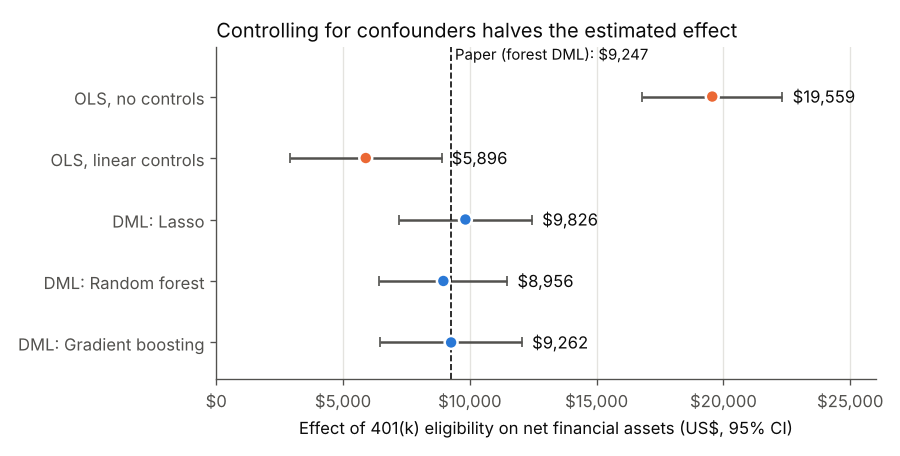
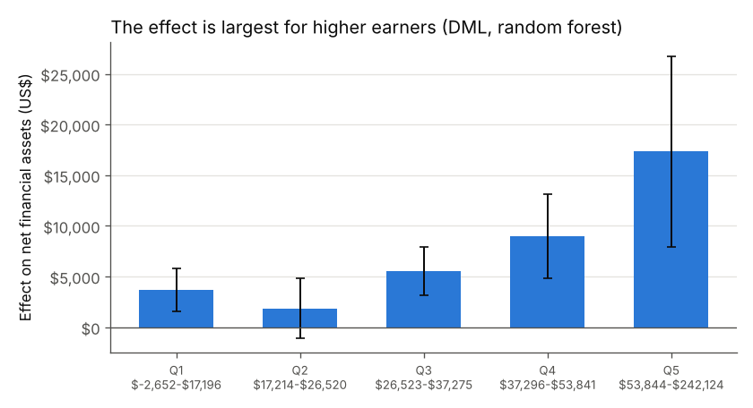

# Do 401(k) Plans Increase Household Savings? OLS vs Double Machine Learning

A replication of a well-known paper that combines **econometrics** (causal inference)
with **machine learning** (prediction), using data on 9,915 US households.

**Question:** If a worker's employer offers a 401(k) retirement plan, does the household
end up with more savings, or does it just move money it would have saved anyway?

**Why it's hard:** eligible households differ from others. They earn about $15k more, are
more educated, and are more likely to own a home. A simple comparison mixes up the
effect of the 401(k) with the effect of being richer. We need to **control** for
those differences, but we don't know the right *shape* of the controls (savings rise
very non-linearly with income and age). This is where machine learning helps.

## Published research this project is based on

| Paper | Role in this project |
|---|---|
| **Chernozhukov, V., Chetverikov, D., Demirer, M., Duflo, E., Hansen, C., Newey, W., & Robins, J. (2018).** "Double/debiased machine learning for treatment and structural parameters." *The Econometrics Journal*, 21(1), C1–C68. [doi:10.1111/ectj.12097](https://doi.org/10.1111/ectj.12097) · [free version](https://arxiv.org/abs/1608.00060) | **The main paper.** It introduces Double Machine Learning (DML), which uses ML to handle the controls and econometrics to estimate the causal effect. Its 401(k) example (Section 6.2, Table 2) is what I replicate. |
| **Poterba, J., Venti, S., & Wise, D. (1995).** "Do 401(k) contributions crowd out other personal saving?" *Journal of Public Economics*, 58(1), 1–32. [doi:10.1016/0047-2727(94)01462-W](https://doi.org/10.1016/0047-2727(94)01462-W) | The original economic question and the argument that, given income, eligibility is close to random because it depends on the employer. |
| **Chernozhukov, V., & Hansen, C. (2004).** "The effects of 401(k) participation on the wealth distribution: An instrumental quantile regression analysis." *Review of Economics and Statistics*, 86(3), 735–751. | Source of the dataset (1991 Survey of Income and Program Participation). |
| **Athey, S., & Imbens, G. (2019).** "Machine Learning Methods That Economists Should Know About." *Annual Review of Economics*, 11, 685–725. [doi:10.1146/annurev-economics-080217-053433](https://doi.org/10.1146/annurev-economics-080217-053433) | Overview of how economists combine ML with causal inference. |

## Data
`data/sipp1991.csv` has 9,915 households from the 1991 SIPP, the same file used in the paper
([source](https://github.com/VC2015/DMLonGitHub)).

| Role | Variable |
|---|---|
| Outcome (Y) | `net_tfa`: net financial assets (US$) |
| Treatment (D) | `e401`: eligible for a 401(k) through the employer |
| Controls (X) | age, income, family size, education, married, two earners, defined-benefit pension, IRA, home owner |

## Methods
1. **OLS, no controls:** the raw gap in savings between eligible and non-eligible households.
2. **OLS with linear controls:** standard econometrics. It assumes every control enters as a straight line.
3. **Double Machine Learning (partially linear model):**
   - Use ML (Lasso, random forest, or gradient boosting) to predict savings from X, and to predict eligibility from X.
   - Keep the residuals: the part of each that X can't explain.
   - Regress the savings residual on the eligibility residual. The slope is the causal effect.
   - Use **cross-fitting** (5 folds) so no household is predicted by a model trained on it.
   - Repeat over 5 random splits and take the median, as in the paper.
4. **Check:** compare my hand-written DML with the official [`doubleml`](https://docs.doubleml.org) package.
5. **Heterogeneity:** run DML separately for each income quintile.

## Results

| Method | Effect of eligibility | Std. error | 95% CI |
|---|---|---|---|
| OLS, no controls | $19,559 | 1,413 | $16,790 to $22,329 |
| OLS, linear controls | $5,896 | 1,524 | $2,909 to $8,883 |
| DML: Lasso | $9,826 | 1,340 | $7,199 to $12,453 |
| **DML: Random forest** | **$8,956** | 1,286 | $6,435 to $11,477 |
| DML: Gradient boosting | $9,262 | 1,425 | $6,469 to $12,055 |
| *DoubleML package (random forest)* | *$9,054* | *1,272* | *check on my code* |
| *Paper: DML random forest, 5 folds* | *$9,247* | *1,295* | *published benchmark* |



**What this shows:**
- **The replication works.** The no-controls estimate matches the paper exactly
  ($19,559, SE 1,413). The DML estimates of roughly $9,000–9,800 are close to the paper's
  $8,187–9,247 range across ML methods (5 folds), and my code agrees with the official package.
- **The naive comparison overstates the effect about 2x.** About half of the raw $19.6k
  gap comes from eligible households being richer and older, not from the 401(k).
- **Linear OLS understates it ($5.9k).** Straight-line controls fit the strongly
  non-linear link between income and wealth badly. The ML methods capture the curve and
  give a larger, more credible estimate. This is the paper's main argument for DML.
- **Different ML methods agree** (all within about $900 of each other), so the result doesn't
  depend on which algorithm is used.

### Who benefits most?

| Income quintile | Income range | Effect | Std. error |
|---|---|---|---|
| Q1 (lowest) | up to $17,196 | $3,651 | 1,078 |
| Q2 | $17,214 – $26,520 | $1,868 | 1,520 |
| Q3 | $26,523 – $37,275 | $5,552 | 1,204 |
| Q4 | $37,296 – $53,841 | $8,989 | 2,129 |
| Q5 (highest) | $53,844 – $242,124 | $17,335 | 4,784 |



The effect is far larger for higher earners, who have more money available to save. The
Q2 estimate is not statistically different from zero.

## Limitations
- The causal reading assumes that, after controlling for X, 401(k) eligibility is
  as good as random (the Poterba–Venti–Wise argument). The design rests on this assumption.
- The data is from 1991, so results describe that period.
- I use 5 repeated splits instead of the paper's 100, to keep the run time short.

## How to run
```bash
pip install -r requirements.txt
python analysis.py        # about 5 minutes; writes tables and charts to results/
```

See **[CODE_GUIDE.md](CODE_GUIDE.md)** for an explanation of every part of the code.
