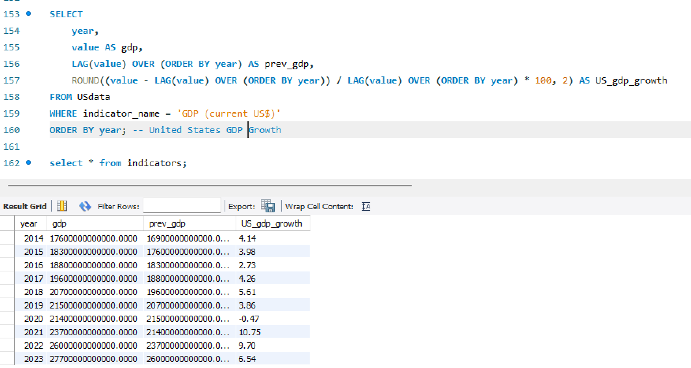
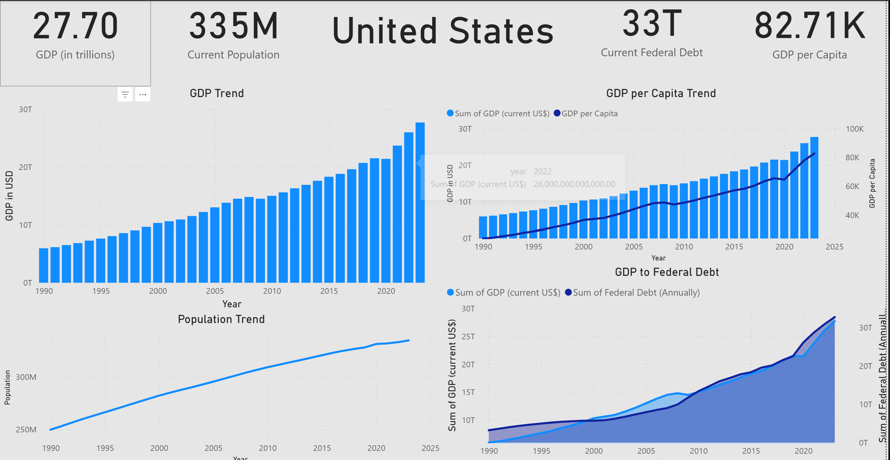

# Analysis Portfolio

## Features
- **SQL** 
- **Power BI**
- **Python** — see [fantasy-football/](fantasy-football/), a Monte Carlo
  simulator that prices fantasy matchups against sportsbook odds

### Overview

I gathered the data from World Bank and FRED to build my portfolio where I used SQL to perform data analysis. I built two tables that contain the list of countries and indicators. Then, I used the two tables and joined them together with the values that correspond to each indicator and country.

I used Excel to combine various indicators and their values, matching them with specific country IDs to create mastersheet2.csv (utilizing VLOOKUP). 

*Also, please note that GDP data is nominal and the rates are not adjusted.*

### Results
#### Top 5 GDP in 2022
    SELECT 
        c.country_name, 
        iv.year, 
        iv.value, 
        i.indicator_name
    FROM indicator_values iv
    JOIN countries c ON iv.country_id = c.country_id
    JOIN indicators i ON iv.indicator_id = i.indicator_id
    WHERE iv.indicator_id = 1 
        AND iv.year = 2022
    ORDER BY iv.value DESC
    LIMIT 5;

1. *United States*
2. *China*
3. *Japan*
4. *Germany*
5. *India*

#### Top 40 High Income Countries by Inflation Rate in Ascending Order (2022)
    SELECT
	iv.year,
    c.country_name,
    c.incomegroup,
    iv.value,
    i.indicator_name
    FROM indicator_values iv
    JOIN countries c ON iv.country_id = c.country_id
    JOIN indicators i ON iv.indicator_id = i.indicator_id
    WHERE iv.indicator_id = 7 
	AND iv.year = 2022
    AND c.incomegroup LIKE '%High income%'
    Order by iv.value ASC
    LIMIT 40;

- *United States at No. 34 with 8.00%*

#### Top 40 High Income Countries by Inflation Rate in Ascending Order (2024)
    SELECT
	iv.year,
    c.country_name,
    c.incomegroup,
    iv.value,
    i.indicator_name
    FROM indicator_values iv
    JOIN countries c ON iv.country_id = c.country_id
    JOIN indicators i ON iv.indicator_id = i.indicator_id
    WHERE iv.indicator_id = 7 
	and iv.year = 2024
    AND c.incomegroup LIKE '%High income%'
    Order by iv.value ASC
    LIMIT 40;

- *United States at No. 36 with 2.95%*

### Visualization

I also created a view table for the US data so it's easier to populate if there are data that need to be added.

    CREATE VIEW USdata AS
    SELECT
    iv.*,
    c.country_name,
    i.indicator_name
    FROM indicator_values iv
    JOIN countries c ON iv.country_id = c.country_id
    JOIN indicators i ON iv.indicator_id = i.indicator_id
    WHERE iv.country_id = 203;

Then, I visualize these data using PowerBI.

---

## Fantasy Football Betting Model

A separate project in [`fantasy-football/`](fantasy-football/): a Python tool
that decides which fantasy team is actually worth betting on.

It pulls a Sleeper league, re-scores every starter's projection under that
league's own scoring rules, and simulates the week 20,000 times — drawing
player scores from skewed distributions and linking teammates through a
shared per-game factor, so a stacked roster swings harder than a spread-out
one. The resulting win probabilities become fair prices, which it compares
against sportsbook odds to find the mispriced side and size the stake by
quarter Kelly.

It also grades itself. `ffbets backtest` replays finished weeks using only
what was knowable beforehand and reports hit rate, Brier score and a
calibration table — on a full 2025 season it beat a coin flip by about 4.6%
Brier skill, which is a real but small edge on a small sample.

Standard library only, no API key.

    cd fantasy-football
    python3 -m ffbets demo                          # synthetic data, no network
    python3 -m ffbets leagues --user your_username  # find your league ID
    python3 -m ffbets analyze --league <id> --odds book.json
