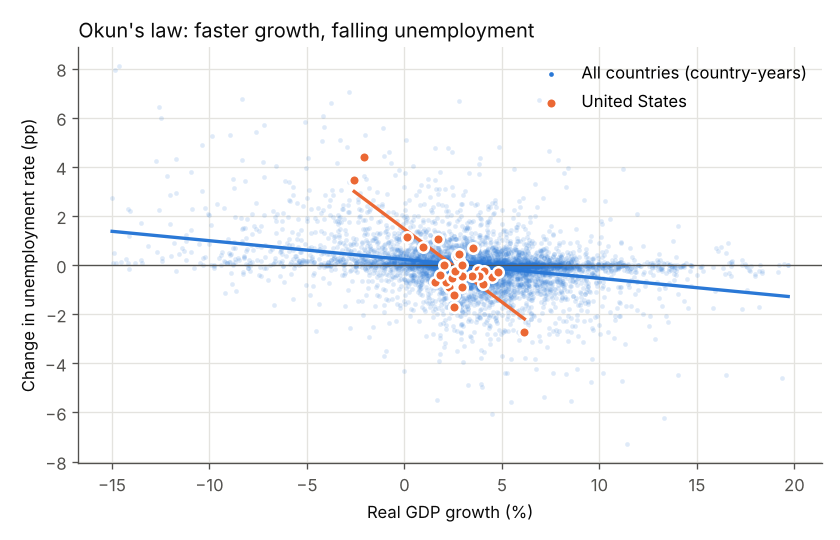
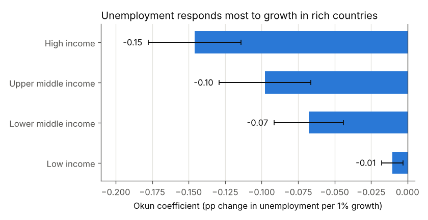
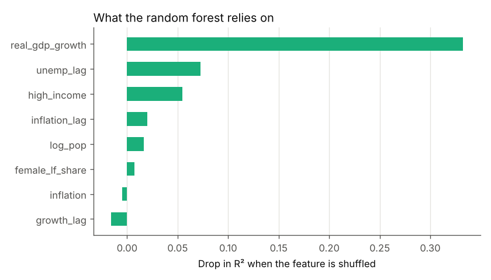
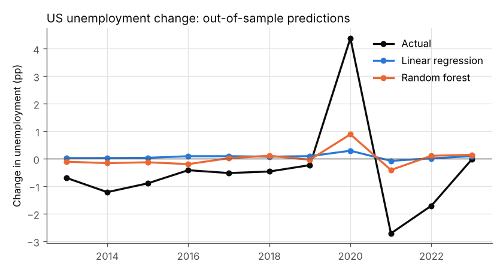

# Okun's Law Across 200+ Countries: Econometrics + Machine Learning

**Question:** When an economy grows faster, how much does unemployment fall, and can a
machine-learning model predict that better than a simple regression?

This project reuses the World Bank data from this repo's SQL project (unemployment,
inflation, labour force, population for 213 countries) and adds **real GDP growth**
from the World Bank API.

## Research it builds on

| Paper | What I took from it |
|---|---|
| Okun, A. M. (1962). "Potential GNP: Its Measurement and Significance." *Proceedings of the Business and Economic Statistics Section, American Statistical Association*, 98–104. | The original "Okun's law": unemployment falls when output grows faster than normal. |
| Ball, L., Leigh, D., & Loungani, P. (2017). "Okun's Law: Fit at 50?" *Journal of Money, Credit and Banking*, 49(7), 1413–1441. [doi:10.1111/jmcb.12420](https://doi.org/10.1111/jmcb.12420) | The relationship is strong and stable in most countries, but **the coefficient differs a lot across countries**. I test this by income group. |
| Mullainathan, S., & Spiess, J. (2017). "Machine Learning: An Applied Econometric Approach." *Journal of Economic Perspectives*, 31(2), 87–106. [doi:10.1257/jep.31.2.87](https://doi.org/10.1257/jep.31.2.87) | ML is built for **prediction**, while econometrics is built for **estimating parameters**. I use both and compare them on data the models have not seen. |
| Breiman, L. (2001). "Random Forests." *Machine Learning*, 45(1), 5–32. | The ML model used here. |

## Method

**1. Econometrics (statsmodels).** I estimate the "difference" version of Okun's law:

```
Δ unemployment(country, year) = a + b × real GDP growth(country, year) + error
```

`b` is the **Okun coefficient**: the percentage-point change in unemployment for each
extra 1% of growth. I estimate it four ways:
- **Pooled OLS:** every country-year in one regression.
- **Country fixed effects:** compares each country only with itself, which removes fixed differences such as labour laws.
- **Country + year fixed effects:** also removes global shocks such as 2009 and 2020.
- **United States only.**

Standard errors are clustered by country. The country fixed-effects model is also
re-run separately for each World Bank income group.

**2. Machine learning (scikit-learn).** The same outcome is predicted from growth,
lagged growth, inflation, last year's unemployment, female labour share, population
and income group. A **linear regression** competes with a **random forest**. Both
train on **1992–2012** and are tested on **2013–2024**, so the models never see the
years they are scored on.

## Results

### Okun's law holds, and it is much stronger in rich countries

| Model | Okun coefficient | Std. error | Obs. |
|---|---|---|---|
| Pooled OLS | −0.077 | 0.007 | 5,719 |
| Country fixed effects | −0.090 | 0.008 | 5,719 |
| Country + year fixed effects | −0.079 | 0.008 | 5,719 |
| **United States only** | **−0.594** | 0.102 | 33 |
| FE: High income | −0.146 | 0.016 | 1,854 |
| FE: Upper middle income | −0.098 | 0.016 | 1,534 |
| FE: Lower middle income | −0.068 | 0.012 | 1,591 |
| FE: Low income | −0.011 | 0.004 | 740 |

All coefficients are negative and statistically significant (p < 0.01).



- **US:** each extra 1% of real growth lowers unemployment by about **0.6 points**.
  From the intercept (1.47), the US needs about **2.5% growth** (1.47 ÷ 0.59) just
  to hold unemployment steady.
- **Across income groups:** the coefficient shrinks from −0.15 in high-income countries to
  almost zero in low-income countries. This matches Ball et al.'s finding that the
  coefficient varies by country. A likely reason is that poorer countries have
  large informal and agricultural sectors, so measured unemployment barely reacts
  to the business cycle.



### Machine learning: the simple model wins

| Model (test years 2013–2024) | RMSE | R² |
|---|---|---|
| Naive (always predict "no change") | 1.023 | −0.017 |
| **Linear regression** | **0.975** | **0.076** |
| Random forest | 0.981 | 0.064 |

- Both models beat the naive guess, but **the random forest does not beat linear
  regression**. The relationship is close to linear, as Okun's law says, so the
  flexibility of the forest adds noise instead of accuracy. This is the
  Mullainathan & Spiess point: ML helps when there is complex structure to find.
- **Permutation importance** shows the forest relies mostly on **real GDP growth**,
  so the ML model independently "discovers" Okun's law.
- R² is low because one pooled model is fitted to all countries, and low-income countries'
  unemployment barely moves. The US chart shows the cost: the pooled models get the
  direction of 2020–21 right but miss its size, because the US is far more responsive
  than the average country.




## Limitations
- Annual data. Okun's law is usually studied with quarterly data.
- Total unemployment is rebuilt from the male and female rates, weighted by labour force share.
- Many World Bank unemployment figures for poorer countries are ILO *modelled
  estimates*, which may smooth real fluctuations.
- Extreme years (growth outside −15% to 20%, or unemployment changes of 10 points or more) are dropped.

## How to run
```bash
pip install -r requirements.txt
python fetch_data.py      # downloads real GDP growth (already saved in data/)
python okun_analysis.py   # runs everything, writes tables and charts to results/
```

See [CODE_GUIDE.md](CODE_GUIDE.md) for a line-by-line explanation of the code.
